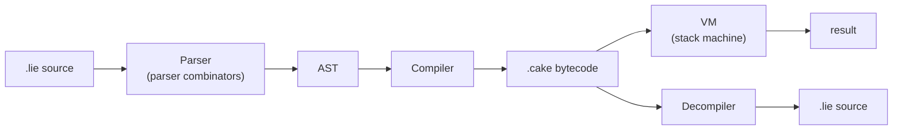

# SLIECE

A small, statically typed functional programming language written in Haskell: a compiler to custom bytecode, a stack-based virtual machine, and a decompiler.

```text
func fact<Int32 n> => Int32
func main<> => Int32

$ fact
    n <= 1 -> 1
    -> n * fact (n - 1)

$ main
    -> fact 5
```

```console
$ ./glados-compiler fact.lie
✅ Compilation Successful! Bytecode written to 'out.cake'
$ ./glados-vm out.cake
120
```

## Features

- **Language**: typed function declarations (`func name<params> => Type`) and definitions (`$ name`), immutable global variables (`define`), recursion, arithmetic, comparison and boolean operators (`&&`, `||`, `!`), and guard-style conditionals (`cond -> value`, with a mandatory final `-> value`)
- **Types**: `Int8` to `Int64`, `UInt8` to `UInt64`, `Float`, `Double`, `Bool`, `String`
- **Hand-written parser combinator library** (`Parsing/`) built on `Functor` / `Applicative` / `Alternative` / `Monad` instances, with explicit syntax error messages
- **Compiler** from source (`.lie`) to a binary bytecode format with a magic header ([bytecode spec](documentation/BytecodeStructure.md))
- **Virtual machine** that executes the bytecode
- **Decompiler** that turns bytecode back into readable SLIECE source
- **Tooling**: unit tests with coverage (`make tests_run`), GitHub Actions CI, Dockerfiles for Ubuntu, Fedora and Arch, and a VS Code syntax-highlighting extension (`vsCodeExtension/`)

## Tech stack

Haskell · Stack · Tasty / HUnit · Docker · GitHub Actions

## Build & run

Requirements: Linux, [Stack](https://docs.haskellstack.org/) and Make. The first build downloads GHC and the dependencies (~10 minutes).

```bash
git clone https://github.com/MartinB-E/SLIECE.git
cd SLIECE
make                                # builds glados-compiler, glados-vm and glados-decompiler

./glados-compiler examples/fact.lie  # writes out.cake
./glados-vm out.cake                # prints the value returned by main
./glados-decompiler out.cake out.lie
```

Function bodies must be indented under their `$ name` line. The full language guide is in [`Doc/SLIECE - User Guide.pdf`](Doc/).

## Architecture



- `Parsing/` — generic parser combinator library
- `compiler/Parser/` — SLIECE grammar: declarations, defines, function bodies, expressions, conditionals
- `compiler/Compiler.hs`, `BytecodeConvertor.hs` — AST to bytecode
- `vm/` — bytecode loader and execution loop
- `decompiler/` — bytecode back to source

## Context

Epitech 3rd-year project (GLaDOS), September – November 2025, team of 5. The project started as an interpreter and evolved into this compiler + VM.
This repository is a copy of the team repository [MYAMBO/GLaDOS](https://github.com/MYAMBO/GLaDOS), kept with its full history.

**Team:** Martin Bonte, Enzo Dubeaurepaire, [Yanis Monté](https://github.com/YanisMonte), [Timoté Koenig](https://github.com/timote1koenig), [Antoine Orange](https://github.com/Antoiix)

**My contribution** (most commits of the team, 90 of ~280):
- Main author of the **SLIECE parser** (`compiler/Parser/`): declarations, `define`, function bodies with multi-line and local variables, expressions with operators and negation, error handling
- The first version of the interpreter (AST and evaluation), before the move to bytecode
- Unit tests for the parser

[À COMPLÉTER : confirmer / corriger ta contribution]
